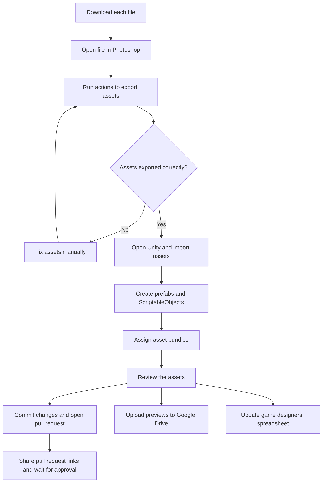
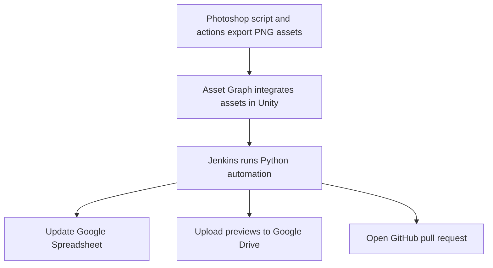

## Technical Artist

### LiveOps art integration

I joined the team to handle LiveOps art integration. Alongside my day-to-day
work, I set aside time to build an automation pipeline that would make my job
easier.
It automated the process shown below, taking it from more than a day of manual
work to under 30 minutes on a cloud-hosted macOS machine.

When I left the project, the pipeline covered about 80% of asset types. Most
manual integration work for those assets was no longer needed. I documented
the pipeline so the team could build on it after I left, and they later
expanded it to all LiveOps assets. This is one of the contributions I'm most
proud of.

### Old manual LiveOps pipeline



### New automated LiveOps pipeline



### Production tools

I also built small tools for Unity, Jenkins, and Git to track project commits
and maintain the GitHub page.

### UI integrations

I worked on UI integrations for the boss battle revamp, daily check-ins, and
other features.

### Shaders and materials

I developed a shader function to process LUTs across the project without
relying on Unity's post-processing stack. Because the render pipeline was
heavily customized, we integrated the function directly into each shader that
needed it. This opened up new visual possibilities for characters, effects,
and customization throughout the game.

```youtube
https://youtu.be/DcvUOqqnc3g?t=60
```