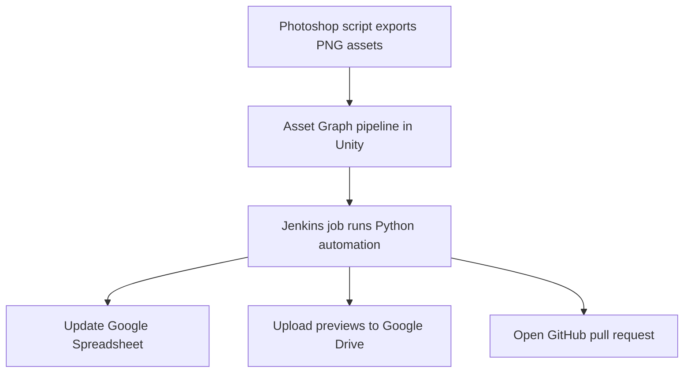

## Technical Artist

**Tools:** I was hired to work on the LiveOps art integration pipeline, which was
mostly manual. After identifying steps that could be automated, we built a
Photoshop script (running alongside actions) to export `.png` files quickly, and
a pipeline for Asset Graph in Unity to integrate the outcomes. Everything was
wired together to run on Jenkins using Python: it updates a Google Spreadsheet,
uploads previews to Google Drive, and opens a GitHub pull request when it
succeeds.

We went from over a day of manual work to a fully autonomous process running in
under 30 minutes on a cloud-based macOS. By the time I left the project this
covered ~80% of asset types, and the team later expanded it to all LiveOps
assets — eliminating the need for a technical artist on this part of the game.
This is one of the contributions I'm most proud of.

I also built small tools for Unity, Jenkins, and Git to help track what's been
committed to the project and maintain the GitHub page.

**UI Integrations:** revamped boss battles, daily check-ins, and other features.

**Shaders and Materials:** developed a shader function to process LUT across the
whole project without relying on Unity's post-processing stack (the render
pipeline was heavily customized, so we integrated the LUT function directly into
every shader that needed it). This unlocked a wide range of new possibilities
for characters, effects, and customization across nearly the entire project.

### LiveOps automation pipeline

