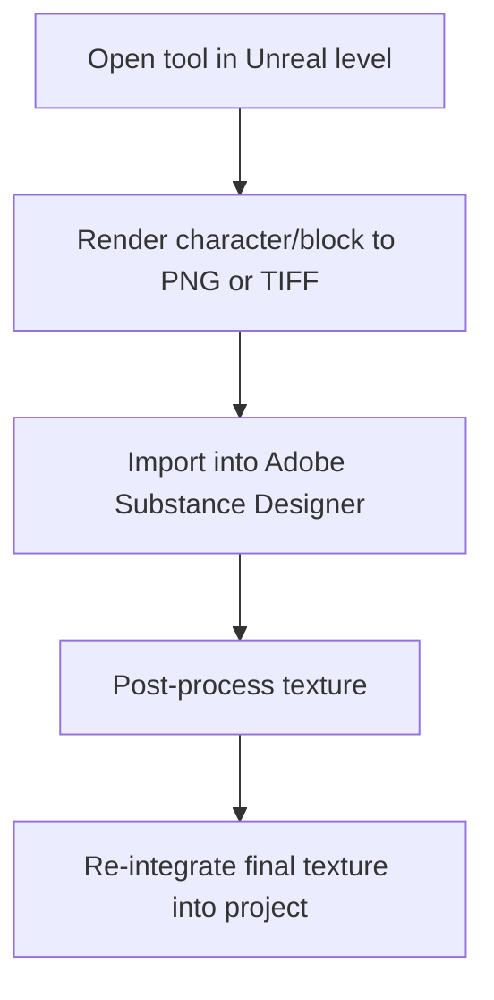

## Tools Technical Artist

I made a few contributions to the project, working about 6 months on 4 major
pieces of work:

- **Character/block screenshot tool** — an in-editor tool to render characters
  and blocks to PNG/TIFF with the full render pipeline enabled, then hand off
  to Adobe Substance Designer for post-processing before re-integrating the
  textures. Built with Unreal Python + Editor Widget Blueprint + Substance
  Python integration.
- **Localization helper tool** — automated the post-Unreal spreadsheet steps
  of the localization pipeline using Python, so the localization team could
  keep working from the same spreadsheet format, plus documentation.
- **DLSS integration**, including UI enhancements to expose the feature.
- **SVG Factory for perfect icons** ✨ — using [msdfgen](https://github.com/Chlumsky/msdfgen),
  a factory that lets a user drag-and-drop an SVG into Unreal and generate a
  texture from parameters (resolution, SDF type: sdf/msdf/mtsdf). Built in C++.

This was by far the most difficult and enjoyable task I had on Wonderbox. When
it shipped internally, Aquiris was acquired by Epic, and I became a Technical
UI Designer on the first team integrated into Fortnite.

### Screenshot tool pipeline

