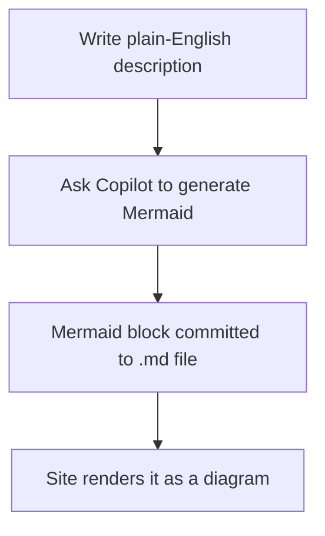

This site is built entirely from Markdown files in the `posts/` folder — no CMS,
no database. Adding a new project, blog post, or page is as simple as adding a
new `.md` file with front-matter.

Diagrams are authored by describing a flow in plain English and asking Copilot
to turn it into a Mermaid block, which renders as an actual diagram on the page:

See [PORTFOLIO_RULES.md](../PORTFOLIO_RULES.md) for the full conventions.
